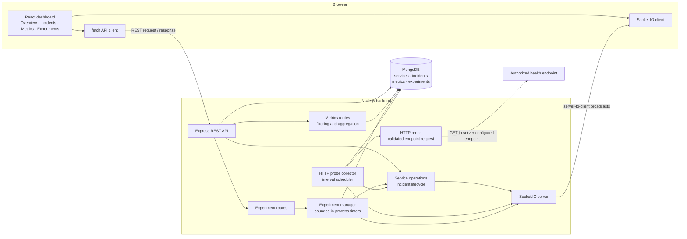
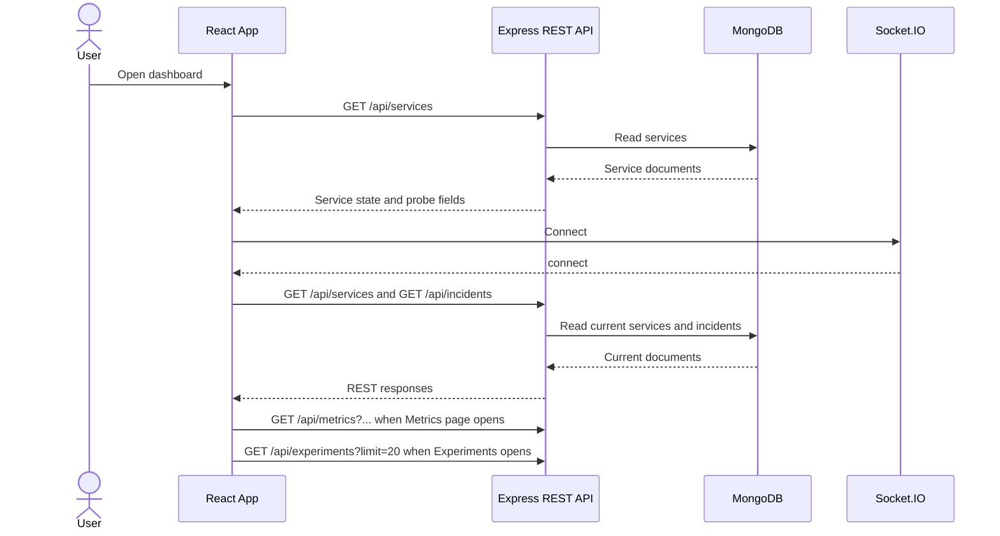
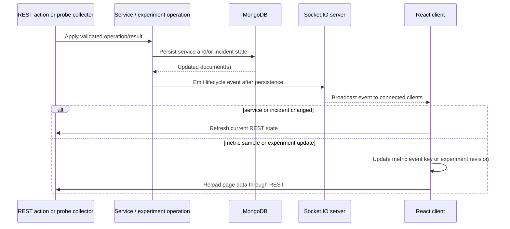
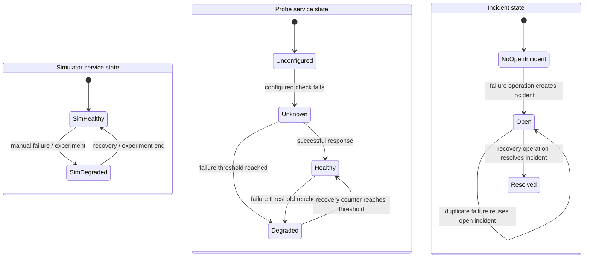
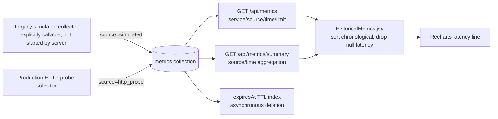
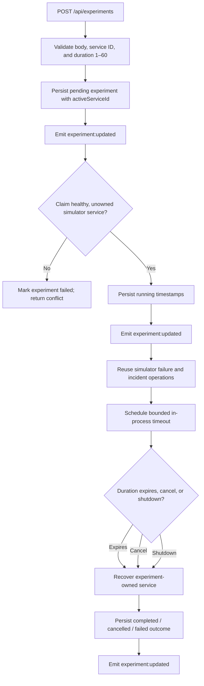
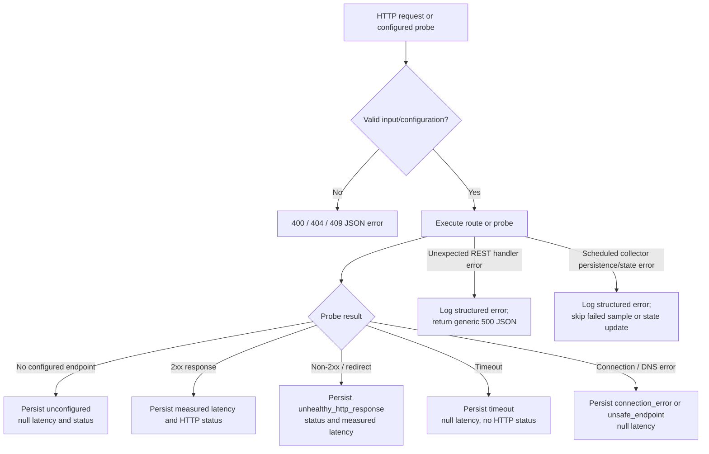
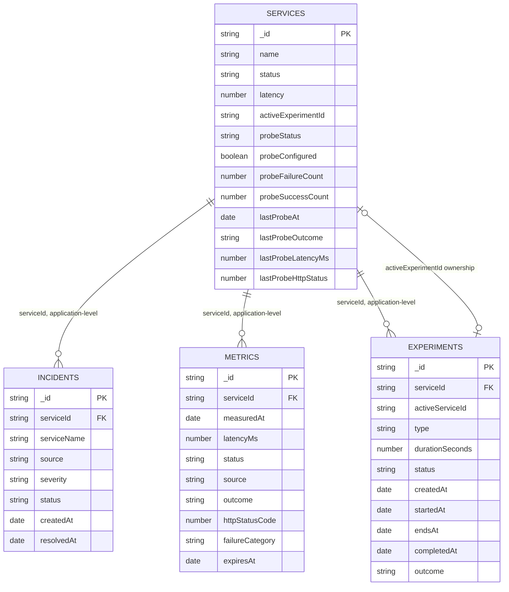

# PulseOps

**A local-first service-monitoring and reliability lab for real HTTP probes, incident workflows, historical latency, and controlled failure experiments.**

PulseOps brings service health observations, incident state, time-series-style
measurements, and recovery exercises into one MERN application. It is designed
to make monitoring and recovery behavior inspectable: a configured probe
produces a persisted result, repeated failures can change probe health and
create an incident, and a bounded simulator experiment demonstrates recovery
without disrupting real infrastructure.

> PulseOps is a development and demonstration platform. It does not include
> authentication or authorization and should not be exposed publicly or used
> to probe systems without authorization. The built-in services are simulator
> records; real HTTP checks run only against explicitly configured endpoints.

**Repository:** [VatsalNegi/PulseOps](https://github.com/VatsalNegi/PulseOps)

**Live demo:** No deployed demo URL is configured in this repository.

Monitoring health and latency helps detect when a dependency stops responding
or slows down. Persisted incidents provide a record of failure and recovery,
while controlled experiments offer a safe way to observe the simulator's
incident and recovery path. PulseOps demonstrates those ideas while keeping
real HTTP probe state distinct from simulated service state and legacy
simulated metric records.

## Contents

- [Capabilities](#capabilities)
- [Screenshots and demo](#screenshots-and-demo)
- [Technology stack](#technology-stack)
- [Architecture](#architecture)
- [System design decisions](#system-design-decisions)
- [Data and request flows](#data-and-request-flows)
- [Algorithms and lifecycle rules](#algorithms-and-lifecycle-rules)
- [Database design](#database-design)
- [API reference](#api-reference)
- [Socket.IO events](#socketio-events)
- [Frontend behavior](#frontend-behavior)
- [Security and reliability](#security-and-reliability)
- [Local development](#local-development)
- [Testing and quality checks](#testing-and-quality-checks)
- [Performance and scalability](#performance-and-scalability)
- [Limitations and roadmap](#limitations-and-roadmap)
- [Project structure](#project-structure)
- [Engineering concepts](#engineering-concepts)
- [Contributing, license, and status](#contributing-license-and-status)

## Capabilities

| Capability | What the implementation does | Main implementation surfaces |
| --- | --- | --- |
| Service dashboard | Displays the three configured simulator services, their independent simulator state, probe configuration, last probe result, and measured latency when present. | `client/src/App.jsx`; `GET /api/services` |
| HTTP health probes | Sends GET requests only to server-side configured service endpoints; records response status and measured request latency, or an explicit failure with null latency. | `server/src/config/healthEndpoints.js`; `server/src/services/httpProbe.js`; `server/src/services/httpProbeCollector.js` |
| Probe health and incidents | Tracks probe outcomes on service records and evaluates failure/recovery thresholds. Probe incidents share the one-open-incident-per-service constraint with simulator incidents. | `server/src/services/serviceOperations.js`; `server/src/models/Incident.js`; `service:probe_updated`, `incident:created`, `incident:resolved` |
| Historical metrics | Stores simulator and HTTP-probe samples with separate `source` values, filters by source/time/service, and aggregates only non-null latency measurements. | `server/src/models/Metric.js`; `server/src/routes/metrics.js`; `client/src/HistoricalMetrics.jsx` |
| Metrics visualization | Provides a service selector, four time ranges, latency line chart, average/minimum/maximum, and sample count. The page requests only HTTP-probe records. | `client/src/HistoricalMetrics.jsx`; Recharts |
| Incident history | Lists open and resolved incidents with severity, source, timestamps, and a status filter. | `GET /api/incidents`; `client/src/App.jsx` |
| Controlled experiments | Starts a simulated service failure for 1–60 seconds, supports cancellation, recovers the simulator service, and stores experiment outcomes. It does not inject faults into the configured HTTP endpoint. | `server/src/services/experimentManager.js`; `client/src/Experiments.jsx`; `/api/experiments` |
| Live updates | Broadcasts persisted service, incident, metric, and experiment changes. The client refreshes relevant resources through REST and reconnects after disconnects. | `server/src/realtime/`; Socket.IO |
| MongoDB persistence | Stores service state, incidents, metrics, and experiments using Mongoose schemas and indexes. | `server/src/models/`; `server/src/db/initializeDatabase.js` |
| Integration testing | Exercises REST, MongoDB persistence, probe HTTP behavior, incidents, experiment lifecycle, and Socket.IO using a dedicated database URI. | `server/tests/api.integration.test.js` |

The application seeds **User Service**, **Order Service**, and **Payment
Service** into MongoDB when absent. Their seeded `status` and `latency` belong
to the simulator. They are not real HTTP observations. With an empty endpoint
map, probe state is explicitly `unconfigured`; no successful real measurement
is fabricated.

## Screenshots and demo

No dashboard screenshots or deployed demo are present in the repository. The
tracked `client/src/assets/hero.png` is a decorative graphic, not an
application screenshot, so it is not presented as one here.

To add genuine screenshots later, capture the running dashboard and save
approved, sanitized images under a new `docs/screenshots/` directory. Suggested
placeholder paths are `docs/screenshots/overview.png`,
`docs/screenshots/metrics.png`, `docs/screenshots/incidents.png`, and
`docs/screenshots/experiments.png`. Useful captures would include:

1. Overview showing real probe status and a clearly distinct simulator state.
2. Metrics with an HTTP-probe latency chart and selected time range.
3. Incident history showing source and lifecycle.
4. Experiments showing a simulated experiment and its recorded outcome.

Only add links or embedded images after the corresponding files exist; redact
local hostnames, private endpoint details, and other sensitive configuration.

## Technology stack

Versions below are the dependency ranges declared in the checked-in package
manifests, not claims about every locally installed patch version.

| Technology | Declared dependency | Actual use |
| --- | --- | --- |
| React | `^19.2.8` | Client-rendered dashboard and page components. |
| Vite | `^8.3.0` | Frontend development server and production bundler. |
| Recharts | `^3.10.1` | Historical latency chart. |
| Socket.IO client | `^4.8.4` | Reconnectable browser connection and server event subscriptions. |
| Node.js | No `engines` range declared | ES module backend, HTTP(S) probe clients, timers, and API server. Node v24.13.0 was available in the inspected development environment; this does not establish a minimum supported version. |
| Express | `^5.3.0` | REST routes, JSON parsing, CORS integration, and error handling. |
| MongoDB / Mongoose | `^9.11.2` Mongoose | Persistent documents, schema validation, conditional updates, and indexes. |
| Socket.IO | `^4.8.4` | Server-side transient real-time events attached to the HTTP listener. |
| dotenv | `^18.0.7` | Loads local server environment variables. |
| Vitest | `^5.0.4` | Backend integration test runner. |
| Supertest | `^7.3.1` | HTTP API testing. |
| ESLint | `^10.10.0` | Frontend lint command. |
| nodemon | `^3.1.14` | Restarts the backend during development. |

The HTTP probe uses Node's built-in `node:http`, `node:https`, `node:dns`,
`node:net`, and `node:perf_hooks` APIs; it adds no HTTP-client dependency.
There is no root package manifest. Install and run client and server
dependencies from their respective directories.

## Architecture



### Architectural layers

- **React client:** `App.jsx` provides custom state-based navigation and
  shared service/incident state. Historical metrics and experiments are
  lazily loaded components.
- **REST API:** `app.js` composes Express middleware and mounts metrics and
  experiment routers. Service actions are handled through the shared service
  operations.
- **Domain operations:** `serviceOperations.js` serializes services and
  incidents, serializes operations per service within one process, and
  implements simulator/probe incident transitions.
- **Background work:** the production server starts the HTTP probe collector
  only after MongoDB initialization. The experiment manager uses persisted
  experiment state and bounded in-process timers.
- **Persistence:** Mongoose models define service, incident, metric, and
  experiment documents. Related IDs are stored as strings; MongoDB does not
  enforce foreign keys between these collections.
- **Real time:** Socket.IO is attached to the Express HTTP server. Broadcasts
  notify connected clients, while REST remains the source of truth.

## System design decisions

| Decision | Why it is used | Trade-off and current boundary |
| --- | --- | --- |
| Separate simulator state from probe state | Existing manual failure controls and experiments continue to operate on simulator `status`/`latency`; HTTP observations live in `probeStatus` and `lastProbe*` fields. | The dashboard must show both domains distinctly. Probe health does not automatically overwrite simulator status. |
| Keep endpoints server-side | Only explicit service-to-URL configuration is accepted by the backend; the service API does not serialize URLs. | Changing endpoints requires backend configuration and a restart. There is no user-managed endpoint API. |
| Persist a metric for configured and unconfigured services | Missing configuration is visible as an `unconfigured` sample, not a fabricated success. | The collector still creates samples for the three seeded services even if they lack endpoints. |
| Keep metric sources separate | `source=simulated` preserves old synthetic records; `source=http_probe` identifies real HTTP checks. The metrics API defaults to the legacy source for compatibility. | Callers must explicitly request `source=http_probe` for real measurements. |
| Use thresholds rather than reacting to every failure | A transient failure need not immediately create an incident; recovery also requires successful observations. | Threshold tracking and service/incident writes are multiple MongoDB operations, not an atomic transaction. Counter behavior is described precisely below. |
| Serialize operations by service in-process | A promise queue coordinates probe transitions and manual/experiment service operations within one Node.js process. | This is not a distributed lock; multiple backend instances can race or advance counters independently. |
| Use MongoDB conditional updates and indexes | Conditional service updates and unique indexes prevent some conflicting transitions and duplicate open/active records. | There is no multi-document transaction or cross-process service-operation queue. |
| Use Socket.IO as notification, REST as state | A connected UI gets low-latency notifications and reloads API state. | Events are not persisted or replayed; reconnect handlers refresh services and incidents. |
| Bound experiments | Experiment durations are limited to 60 seconds and one active experiment per service is enforced with a unique sparse index. | Execution timers live in process memory and are not a durable distributed job queue. Startup reconciliation handles persisted active records. |

The backend provides structured JSON logging and generic unexpected-error
responses. It does not currently implement authentication, authorization,
rate limiting, distributed coordination, transaction-based state changes, or
durable event delivery.

## Data and request flows

### A. Initial dashboard loading

Service state is fetched immediately after mount and then every three seconds.
Incidents are loaded on Socket.IO connection and when the Incidents page is
selected. Metrics and experiment history are loaded when their lazy page
components mount.



The two service fetches in this diagram represent the regular service refresh
and the additional refresh triggered after a successful Socket.IO connection.

### B. Real-time event flow



The client refreshes services on `service:failure`,
`service:recovered`, and `service:probe_updated`; it refreshes incidents on
`incident:created` and `incident:resolved`. A `metrics:sample` stores the
latest event ID by service, causing the selected Metrics page to reload. An
`experiment:updated` increments a revision so the Experiments page reloads
history. A new Socket.IO connection triggers service and incident REST
refreshes.

### C. HTTP health-probe lifecycle

```mermaid
sequenceDiagram
  participant Server as server.js
  participant Collector as HTTP probe collector
  participant Config as Validated endpoint map
  participant Probe as HTTP probe
  participant Target as Configured endpoint
  participant DB as MongoDB
  participant Operations as applyProbeResult
  participant Socket as Socket.IO
  Server->>Collector: Start after database initialization
  Collector->>DB: Mark service probe configuration
  Collector->>Collector: Run immediate collection; schedule interval
  Collector->>DB: Query registered service IDs
  Collector->>Config: Find endpoint for each service
  alt endpoint configured
    Collector->>Probe: Probe URL with timeout and development policy
    Probe->>Probe: Validate / resolve and pin permitted address
    Probe->>Target: HTTP GET
    Target-->>Probe: Response, connection failure, or timeout
    Probe->>Probe: Measure request-to-response duration with performance.now()
    Probe-->>Collector: Outcome, status, latency or null
  else endpoint missing
    Collector->>Collector: Create explicit unconfigured result
  end
  Collector->>DB: Persist source=http_probe metric
  Collector->>Operations: Apply outcome to service probe state
  Operations->>DB: Update last result and threshold counters
  opt Failure threshold reached
    Operations->>DB: Create or reuse open incident
  end
  opt Recovery threshold reached
    Operations->>DB: Resolve open HTTP-probe incident
  end
  Operations->>Socket: Emit transition / incident event as applicable
  Collector->>Socket: Emit metrics:sample after state handling
```

The endpoint map is validated during server startup. Individual check failures
are converted to explicit outcomes and do not stop checks for other configured
services. The HTTP response is classified when response headers arrive; the
probe destroys the response rather than downloading an arbitrary response
body.

### D. Service and incident lifecycle

The simulator lifecycle and probe lifecycle are distinct. `status` is used by
the manual simulator and experiment; `probeStatus` is driven by HTTP
observations. An open incident is unique per service, regardless of source.



Probe state transitions do not modify simulator status, including when an
experiment owns the service. Probe observations and counters are still
recorded in that case, but probe-driven health transitions and incident
changes are skipped. The incident lifecycle is service-wide: because the
unique open-incident index is on `serviceId`, an existing incident from one
source may be reused by another source. Simulator recovery resolves any open
incident; probe recovery only resolves an open `http_probe` incident.

### E. Historical metrics



The summary counts all matching samples but excludes null latency from
`measurementCount`, average, minimum, and maximum. The chart fetch is capped
at 500 records; summary aggregation is not capped by that chart limit.

### F. Reliability experiment lifecycle



The service claim uses a per-service in-process operation queue and a
conditional MongoDB update. A unique sparse index on `activeServiceId` also
allows only one pending/running experiment for a service. Restart reconciliation
resumes a still-owned running experiment until its deadline, completes an
expired one, or marks inconsistent/interrupted records failed. Shutdown
attempts safe recovery before stopping timers and MongoDB.

### G. Error handling



Invalid endpoint configuration is rejected at server startup. API errors use
`{ "success": false, "message": "..." }`; unexpected exceptions are logged
with request context and do not expose stack traces or database details.

## Algorithms and lifecycle rules

### HTTP probe

**Purpose:** Observe whether an explicitly configured HTTP endpoint returns a
successful response and record measured request latency.

**Inputs:** A validated service endpoint, request timeout, and the development
loopback flag.

**Behavior:**

1. Look up a server-configured endpoint for each seeded service.
2. If none exists, record outcome `unconfigured`, with null latency/status.
3. For external hosts, resolve DNS and reject the check if an answer is
   classified as non-public; pin the selected address for the request. For
   explicitly enabled development loopback, use the loopback address directly.
4. Start a request timeout and monotonic timer; issue HTTP GET.
5. On response headers, stop timing and classify any 2xx as success. Every
   other status, including redirects, is unhealthy. Redirects are not followed.
6. On timeout or connection failure, return null latency and no status code.
7. Persist a metric. Then update service probe fields/counters, apply any
   incident transition, and emit the metric event.

```text
for each registered service, concurrently:
    endpoint = configuredEndpoints[service.id]
    if endpoint is absent:
        result = unconfigured(latency=null, httpStatus=null)
    else:
        address = validateAndResolve(endpoint)
        if address is unsafe:
            result = unsafe_endpoint(latency=null, httpStatus=null)
        else:
            start monotonic clock and timeout
            issue GET using pinned address
            if response arrives:
                latency = elapsed time until response headers
                result = success if status is 2xx, otherwise unhealthy_http_response
            else if timeout:
                result = timeout(latency=null, httpStatus=null)
            else:
                result = connection_error(latency=null, httpStatus=null)

    persist result as source=http_probe
    apply probe result to service unless an active experiment owns it
    emit metrics:sample
```

**Timing detail:** DNS resolution occurs before `performance.now()` starts the
HTTP request timer. The stored latency measures request start to response
headers, not DNS resolution or full response-body download. Failed checks
without a response have no fabricated latency.

**Costs and limits:** The collector queries the registered service records
once per cycle and dispatches one asynchronous probe per service through
`Promise.all`; service orchestration is O(S) for S registered services, while
network and database latency dominate the work. One active collector cycle is
allowed per process. An OS DNS lookup that loses a timeout race may continue
in the resolver because it cannot always be cancelled.

### Failure and recovery counters

**Purpose:** Avoid transitioning probe status on an isolated failure and
require multiple successful observations after a degraded state.

**Configuration defaults:** `HEALTH_FAILURE_THRESHOLD=3` and
`HEALTH_RECOVERY_THRESHOLD=2`; each value is validated from 1 through 10.

**Fields:** `probeFailureCount`, `probeSuccessCount`, and `probeStatus` on the
service document.

```text
on probe outcome for a service:
    persist lastProbeAt, lastProbeOutcome, lastProbeLatencyMs, lastProbeHttpStatus
    if outcome is unconfigured or unsafe_endpoint:
        set probeStatus to unconfigured or unknown
        return

    if outcome is success:
        increment probeSuccessCount
        if active experiment owns service:
            stop before probe-status or incident transitions
        if current probeStatus is degraded:
            if probeSuccessCount >= recoveryThreshold:
                resolve an open http_probe incident if present
                set probeStatus=healthy and probeFailureCount=0
                emit service:probe_updated
        else:
            set probeStatus=healthy and probeFailureCount=0
            emit service:probe_updated on a status transition
        return

    increment probeFailureCount
    if active experiment owns service:
        stop before probe-status or incident transitions
    if probeFailureCount >= failureThreshold:
        create or reuse the service's open incident
        set probeStatus=degraded and probeSuccessCount=0
        emit service:probe_updated on a status transition
    else if prior state was unconfigured:
        set probeStatus=unknown
```

**Important implementation limitation:** Before the service reaches degraded,
a successful probe resets `probeFailureCount`, so failures must reach the
threshold without an intervening success. Once degraded, the current code
increments `probeSuccessCount` on success but does **not** reset it when a
failure occurs before recovery; recovery counts can therefore be cumulative
rather than a strict consecutive-success streak. Likewise, while already
degraded, `probeFailureCount` is not reset on a success that has not yet met
the recovery threshold. The configured values are counter thresholds, not a
fully strict streak algorithm in every degraded-state edge case. Tightening
this behavior is a future code change, not a README claim.

At the threshold, `createIncident()` first searches for any open incident for
the service. MongoDB's unique partial index permits at most one open incident
per service. If another source already owns that incident, the probe uses the
existing one rather than creating a second incident.

### Simulator failure and recovery

Manual failure changes `status=healthy` to `status=degraded` and sets
simulator latency to 5000. The operation creates or reuses an open incident
and emits `service:failure`; a repeated failure on an already degraded service
is idempotent and returns an “already degraded” success response. If incident
creation fails after the service update, the code attempts a compensating
service update. Incident severity is derived from the service's simulator
`latency` field (`critical` at 3000 ms or higher, otherwise `warning`); probe
incidents do not currently calculate severity from HTTP response latency.

Recovery conditionally restores `status=healthy`, the configured simulator
baseline latency, and clears experiment ownership where applicable. It
resolves the open incident and emits `incident:resolved` when one existed,
followed by `service:recovered`. If resolution fails after a state transition,
the code attempts a compensating degraded-state update. These are separate
MongoDB operations, not one transaction; a process crash can leave temporary
cross-document inconsistency.

### Metric recording, query, and retention

- The production `server.js` starts `httpProbeCollector.js`, not the legacy
  synthetic `metricsCollector.js`.
- The legacy collector remains in the repository for simulator metric
  compatibility/testing and writes `source=simulated`.
- Probe samples use `source=http_probe`; unconfigured services also produce
  explicit probe samples with null latency.
- `GET /api/metrics` accepts optional `serviceId`, `from`, `to`, `limit`, and
  `source`. The default source remains `simulated`. The limit defaults to 100
  and is capped at 500.
- `GET /api/metrics/summary` uses the same service, date, and source filters.
  `count` includes samples even if latency is null; `measurementCount` and
  latency aggregations use measured values only.
- `expiresAt` is indexed with MongoDB's TTL policy. TTL cleanup is
  asynchronous, so expired records may remain briefly after their expiry.

### Reliability experiments

**Purpose:** Safely demonstrate simulated failure and automatic recovery.

**Inputs and bounds:** Existing service ID and whole-number
`durationSeconds` from 1 through 60. Extra body properties are rejected.

```text
validate service ID and duration
persist experiment(status=pending, activeServiceId=serviceId)
claim service only if simulator status is healthy and no experiment owns it
persist status=running, startedAt, endsAt
simulate failure through shared service operation
schedule one in-process timeout for endsAt

on timeout or cancellation:
    recover only while this experiment owns the service
    persist terminal status, completion time, and outcome
    clear activeServiceId

on startup:
    examine at most three active records
    reconcile pending/interrupted ownership
    resume a still-owned unexpired running experiment
    complete an expired running experiment
```

Cancellation applies only to a running experiment. Shutdown cancels timers and
attempts safe recovery for running work, marking the experiment failed for
shutdown as appropriate. A unique sparse index on `activeServiceId` prevents
two active experiment documents for one service across database writers; the
timer/scheduler itself is process-local.

## Database design

Mongoose uses its default plural collection names. IDs and relationships are
application-level strings; there are no MongoDB foreign keys or declared
Mongoose `ref` relationships among these models.



`FK` labels in this diagram mean logical/application relationships only; they
are **not** MongoDB foreign-key constraints.

| Model / collection | Important fields and validation | Relationships | Indexes / retention |
| --- | --- | --- | --- |
| `Service` / `services` | String `_id`; required `name`, `status` (`healthy`/`degraded`), nonnegative simulator `latency`; probe status (`unconfigured`/`unknown`/`healthy`/`degraded`), config flag, counters, last outcome/time/latency/status. | `activeExperimentId` stores experiment ownership; service IDs are used in other models. | No explicit schema index beyond `_id`. |
| `Incident` / `incidents` | String `_id`; service ID/name; title/description; source (`simulator`/`http_probe`); severity (`warning`/`critical`); status (`open`/`resolved`); creation and optional resolution dates. | `serviceId` identifies the affected service; no ref or FK. | Unique partial index on `serviceId` where `status=open`, enforcing one open incident per service. |
| `Metric` / `metrics` | String `_id`; supported service ID; `measuredAt`; nullable nonnegative `latencyMs`; status (`healthy`/`degraded`/`unconfigured`); source (`simulated`/`http_probe`); outcome, HTTP status, failure category, sampling interval, expiry. | `serviceId` is an application-level service identifier. | `{serviceId:1, measuredAt:-1}` and TTL index `{expiresAt:1}` with `expireAfterSeconds:0`. |
| `Experiment` / `experiments` | String `_id`; supported service ID; optional `activeServiceId`; type (`simulated_service_failure`); duration 1–60; status (`pending`/`running`/`completed`/`cancelled`/`failed`); lifecycle timestamps and outcome. | `serviceId` targets service; `activeServiceId` participates in single-active-experiment enforcement. | Unique sparse `{activeServiceId:1}`; history `{createdAt:-1}`. |

Database startup connects using `MONGODB_URI`, ensures the models' indexes,
and upserts missing default services without replacing existing service state.
There is no transaction spanning service, incident, metric, or experiment
collections.

## API reference

All routes are under `/api`. There is no authentication or authorization.
Unexpected errors are returned as a generic 500 JSON response and logged
server-side. Unless noted, JSON failures use:

```json
{ "success": false, "message": "Explanation" }
```

### Health and service status

| Method and path | Request | Success response | Important errors / validation |
| --- | --- | --- | --- |
| `GET /api/health` | None | `200`: `{ "success": true, "message": "PulseOps API is running" }` | None. |
| `GET /api/services` | None | `200`: `{ "success": true, "count": 3, "data": [...] }`. Each service includes `id`, `name`, simulator `status`/`latency`, `probeConfigured`, `probeStatus`, `lastProbeAt`, `lastProbeOutcome`, `lastProbeLatencyMs`, `lastProbeHttpStatus`. | Probe endpoint URLs are never included. |
| `POST /api/services/:id/failure` | Empty body | `200`: `{ success, message, data, incident }` on transition; repeated already-degraded failure returns success with service `data` and no new incident field. | `400` invalid ID or unsupported body; `404` unknown service; `409` service owned by active experiment. |
| `POST /api/services/:id/recover` | Empty body | `200`: `{ success, message, data, incident }`; incident is `null` if there was no open incident. | `400` invalid ID or unsupported body; `404` unknown service; `409` experiment ownership/state conflict. |

Service ID syntax is lowercase letters followed by lowercase letters,
digits, or hyphens, up to 64 characters. Only the three IDs in
`server/src/config/services.js` are supported.

### Incidents

| Method and path | Request | Success response | Important behavior |
| --- | --- | --- | --- |
| `GET /api/incidents` | None | `200`: `{ "success": true, "count": n, "data": [...] }`; newest first. | Items contain ID, service ID/name, title, description, source, severity, status, creation and resolution timestamps. |

Incident source is `simulator` or `http_probe`. An incident is resolved via
the shared simulator recovery operation, or by the probe recovery threshold
when it is an HTTP-probe incident.

### Metrics and summaries

| Method and path | Query parameters | Success response | Important errors / validation |
| --- | --- | --- | --- |
| `GET /api/metrics` | Optional `serviceId`, `from`, `to`, `limit`, `source` | `200`: `{ success, count, total, limit, data }`, newest first. `data` includes `id`, `serviceId`, `timestamp`, nullable `latencyMs`, `status`, `source`, `outcome`, nullable `httpStatusCode`, nullable `failureCategory`. | `400` unknown/repeated query parameter, invalid date/source/limit; `404` unknown service. |
| `GET /api/metrics/summary` | Optional `serviceId`, `from`, `to`, `source`; no `limit` | `200`: `{ success, data: { count, measurementCount, averageLatencyMs, minimumLatencyMs, maximumLatencyMs, byStatus, bySource } }`. | `400` invalid query or `limit`; `404` unknown service. |

`source` is `simulated` or `http_probe`; it defaults to **simulated** to
preserve the older API behavior. The Metrics UI explicitly uses
`source=http_probe`. Date bounds must be timezone-qualified ISO timestamps;
when both are supplied they are inclusive and `from` must be earlier than
`to`. `limit` defaults to 100 and ranges from 1 to 500. Summary latency fields
are null when no matching sample has a numeric latency.

Examples:

```powershell
curl.exe "http://127.0.0.1:5000/api/metrics?serviceId=user-service&source=http_probe&limit=50"
curl.exe "http://127.0.0.1:5000/api/metrics/summary?serviceId=user-service&source=http_probe"
```

### Reliability experiments

| Method and path | Request | Success response | Important errors / validation |
| --- | --- | --- | --- |
| `POST /api/experiments` | JSON `{ "serviceId": "payment-service", "durationSeconds": 10 }` | `201`: `{ "success": true, "data": experiment }`; creates and starts a simulated failure experiment. | `400` extra/missing/invalid fields or duration outside 1–60; `404` unknown service; `409` another experiment is active or service cannot be claimed. |
| `GET /api/experiments?limit=20` | `limit` optional, defaults to 20, range 1–100 | `200`: `{ success, count, data }`, newest first. | `400` invalid limit. |
| `GET /api/experiments/:id` | Experiment ID | `200`: `{ success, data: experiment }`. | `404` experiment not found. |
| `POST /api/experiments/:id/cancel` | Empty body | `200`: `{ success, data: experiment }`. | `400` body not supported; `404` experiment not found; `409` only running experiments can be cancelled or it completed first. |

Experiment data contains `id`, `serviceId`, `type`,
`durationSeconds`, `status`, `createdAt`, `startedAt`, `endsAt`,
`completedAt`, and `outcome`. Experiments alter only simulator state; they
do not make an HTTP endpoint return failure.

### Curl examples for simulator operations

```powershell
curl.exe -X POST "http://127.0.0.1:5000/api/services/payment-service/failure"
curl.exe -X POST "http://127.0.0.1:5000/api/services/payment-service/recover"
curl.exe -X POST "http://127.0.0.1:5000/api/experiments" `
  -H "Content-Type: application/json" `
  -d "{\"serviceId\":\"payment-service\",\"durationSeconds\":10}"
curl.exe "http://127.0.0.1:5000/api/experiments?limit=20"
```

## Socket.IO events

All application events below are **server-to-client broadcasts**. The client
does not emit application commands over Socket.IO; writes use REST. Payloads
are transient and are not stored as an event log.

| Event | Typical payload | Trigger and client behavior |
| --- | --- | --- |
| `service:failure` | `{ eventId, occurredAt, service, incident }` | Simulator service has been persisted degraded and its incident handled; client refreshes services. |
| `service:recovered` | `{ eventId, occurredAt, service, incident }`; incident may be `null` | Simulator service recovery completed; client refreshes services. |
| `incident:created` | `{ eventId, occurredAt, service, incident }` | Incident persisted; client refreshes incident history. |
| `incident:resolved` | `{ eventId, occurredAt, service, incident }` | Incident resolution persisted; client refreshes incident history. |
| `service:probe_updated` | `{ eventId, occurredAt, serviceId, status, outcome, httpStatusCode, incident? }` | Probe health status transitions; client refreshes services. |
| `metrics:sample` | `{ eventId, timestamp, serviceId, latencyMs, status, source, outcome?, httpStatusCode?, failureCategory? }` | Sample persisted; client records the event ID and the selected Metrics view reloads through REST. |
| `experiment:updated` | `{ eventId, experiment }` | Experiment lifecycle record persisted; client increments a revision and reloads history. |

Payload `service` objects use the service API fields; `incident` objects use
the incident response fields. Client connection lifecycle events are Socket.IO
events `connect`, `disconnect`, and `connect_error`, not application
broadcasts. The client reconnects indefinitely with a 1-second initial delay
and a 5-second maximum configured delay. On reconnection it reloads services
and incidents. Listener cleanup and socket disconnect occur when the React
app unmounts.

## Frontend behavior

There is no React Router. `App.jsx` uses `page` state to select the active
sidebar page. Overview and Services share the service dashboard surface;
Incidents displays the incident list; Metrics and Experiments are lazy-loaded
components.

```text
StrictMode
└── App
    ├── Overview / Services: service cards, simulator controls, probe state
    ├── Incidents: filters, source, timestamps, open/resolved history
    ├── HistoricalMetrics: filters, summary cards, Recharts line chart
    └── Experiments: configuration review, start/cancel, elapsed time, history
```

`client/src/api.js` derives the API base from `VITE_API_URL`, defaulting to
`http://localhost:5000/api`; Socket.IO connects to that URL's origin.
Services refresh every three seconds and when relevant events arrive.
Historical metrics use browser-generated `from`/`to` ISO bounds for 15
minutes, 1 hour, 6 hours, or 24 hours; the chart data is sorted chronologically
and skips null-latency samples. Summary cards represent the API's complete
selected window while the chart request is capped at 500 points.

The views include loading, empty, and API-error states. Experiments display
elapsed time from their persisted `startedAt` value while running. Styling is
in `client/src/App.css` and `client/src/index.css`; the layout includes narrow
viewport media rules, but no browser automation suite is present in the
repository.

## Security and reliability

### HTTP probe endpoint restrictions

`HEALTH_ENDPOINTS_JSON` is parsed as a service-ID-to-URL JSON object at server
startup. Only known service IDs are accepted. Endpoint URLs:

- Must use HTTP or HTTPS.
- Cannot contain URL credentials or fragments.
- Must use HTTPS for non-loopback hosts.
- Must have an exact hostname entry in `HEALTH_ALLOWED_HOSTS` for external
  endpoints.
- May use loopback only when both `NODE_ENV=development` and
  `HEALTH_ALLOW_LOCAL_HTTP=true`.

For external hosts, DNS answers are checked against a code-defined public
address classifier; the request uses the selected validated IP to reduce DNS
rebinding risk. Redirect responses are never followed, so a configured host
cannot redirect the probe to a second destination. The endpoint map is not
returned by service APIs and should be kept in server environment
configuration.

These controls reduce risk but are not a substitute for network egress
restrictions. Address classification has limits, DNS resolution may continue
in the OS after the probe timeout race returns, and allowlisting a hostname
authorizes requests to all its paths and ports. Use dedicated health endpoints
and restrictive network policy. Do not enable loopback probing in production.

### Other safeguards and boundaries

- Express JSON requests are limited to 16 KiB; malformed and oversized JSON
  receive JSON errors.
- The default server listener does not set `HOST`, so Node binds its default
  unspecified address. Bind `HOST` to a local interface for a local-only
  deployment; the API has no authentication.
- Service IDs, metric filters, date bounds, metric sources, limits,
  experiment fields, durations, and history limits are validated.
- CORS allows local dashboard origins and configured `CLIENT_ORIGIN` values.
  CORS is not authentication; API endpoints have no auth or authorization.
- Unexpected request failures use structured JSON logs and generic client
  errors. The logger writes timestamped JSON records to stdout/stderr.
- Service operations are queued per service in one process and use MongoDB
  conditional updates. Incident and active-experiment indexes add database
  constraints.
- Startup initializes MongoDB and indexes before starting the collector.
  SIGINT/SIGTERM trigger experiment cleanup, collector stop, Socket.IO close,
  HTTP close, and MongoDB disconnect; HTTP shutdown has a 10-second default
  bound.
- Tests require `MONGODB_TEST_URI` and verify the connected database name is
  `pulseops_test` before cleanup. They delete documents from test collections;
  they do not drop the database.

No authentication, authorization, rate limiting, audit log, database
transaction, distributed lock, or durable background queue is implemented.

## Local development

### Prerequisites

- Node.js and npm. The repository does not declare a Node.js engines range;
  Node v24.13.0 was the available version in the inspected development
  environment.
- A reachable MongoDB instance. No Docker Compose, MongoDB container
  definition, or automated database provisioning is included.
- PowerShell on Windows for the commands below.

### Clone and install

```powershell
git clone https://github.com/VatsalNegi/PulseOps.git
Set-Location .\PulseOps

Set-Location .\server
npm install

Set-Location ..\client
npm install
```

There is no root-level `npm install` script or root package manifest.

### Configure MongoDB and backend

The backend's local environment template is `server/.env.example`. Copy it,
then edit `server/.env` with the MongoDB URI appropriate for your local
instance. Do not commit `server/.env`.

```powershell
Set-Location .\server
Copy-Item .env.example .env
notepad .env
```

The template's `MONGODB_URI` targets a local `pulseops` database. The API
defaults to port 5000. Start MongoDB separately using your chosen local
installation or managed development instance; this repository does not
provide a database container.

Start the backend in **Terminal 1**:

```powershell
Set-Location C:\path\to\PulseOps\server
npm run dev
```

`npm run dev` executes `nodemon src/server.js`; `npm start` runs Node directly.
The API defaults to `http://localhost:5000`.

Start the frontend in **Terminal 2**:

```powershell
Set-Location C:\path\to\PulseOps\client
npm run dev
```

Vite defaults to `http://localhost:5173`. The client uses
`http://localhost:5000/api` unless `VITE_API_URL` is set.

### Configure an authorized real endpoint

By default `HEALTH_ENDPOINTS_JSON={}`; services remain unconfigured. To monitor
an external endpoint, use a URL you own or are explicitly authorized to
monitor, require HTTPS, and add its exact hostname to `HEALTH_ALLOWED_HOSTS`.
Keep the URL server-side. Do not use a public service URL as a demo target or
enter a URL supplied by an untrusted user.

For a controlled local demonstration, the repository provides its own endpoint
and a process-scoped backend launcher. In two additional terminals:

```powershell
# Terminal 3: test endpoint, bound only to 127.0.0.1:5055
Set-Location C:\path\to\PulseOps\server
node src\dev\localHealthServer.js

# Terminal 4: backend on 127.0.0.1:5001, using the development pulseops DB
Set-Location C:\path\to\PulseOps\server
.\scripts\start-local-probe-backend.ps1
```

The demo launcher configures only `user-service` to use
`http://127.0.0.1:5055/health`, sets the explicit development loopback
permission and allowlist entry, and shortens the sampling interval for the
demo. It targets the existing development `pulseops` database; it does not
clear it. Do not use this launcher or loopback permission in production.

Switch the local endpoint between 503 and 200:

```powershell
Invoke-RestMethod -Method Post -Uri "http://127.0.0.1:5055/__mode" `
  -ContentType "application/json" -Body '{"statusCode":503}'
Invoke-RestMethod -Method Post -Uri "http://127.0.0.1:5055/__mode" `
  -ContentType "application/json" -Body '{"statusCode":200}'
```

To use the demo backend from Vite, launch the client with:

```powershell
Set-Location C:\path\to\PulseOps\client
$env:VITE_API_URL = "http://127.0.0.1:5001/api"
npm run dev
```

The local endpoint control route binds to the same loopback-only server and
accepts only status 200 or 503. Stop only the terminals started for the demo
with Ctrl+C.

### Configuration reference

| Variable | Default in `server/.env.example` | Purpose |
| --- | --- | --- |
| `PORT` | `5000` | Express/Socket.IO HTTP port. |
| `HOST` | Unset | Optional listener binding address. |
| `CLIENT_ORIGIN` | `http://localhost:5173` | Additional comma-separated browser origins. |
| `MONGODB_URI` | Local `pulseops` database URI | Required backend database connection. |
| `MONGODB_TEST_URI` | Local `pulseops_test` URI | Test database URI; set explicitly when running tests. |
| `METRICS_ENABLED` | `true` | Enables production HTTP probe collection. |
| `METRICS_SAMPLING_INTERVAL_MS` | `30000` | Sampling interval, valid range 1,000–86,400,000 ms. |
| `METRICS_RETENTION_DAYS` | `7` | Metric retention days, valid range 1–365. |
| `HEALTH_PROBE_TIMEOUT_MS` | `5000` | Request timeout, valid range 100–60,000 ms. |
| `HEALTH_FAILURE_THRESHOLD` | `3` | Probe failure threshold, valid range 1–10. |
| `HEALTH_RECOVERY_THRESHOLD` | `2` | Probe recovery threshold, valid range 1–10. |
| `HEALTH_ENDPOINTS_JSON` | `{}` | Server-only mapping of known service IDs to health-check URLs. |
| `HEALTH_ALLOWED_HOSTS` | Empty | Comma-separated exact host allowlist for non-loopback HTTPS endpoints. |
| `HEALTH_ALLOW_LOCAL_HTTP` | `false` | Must be true with `NODE_ENV=development` to permit loopback checks. |
| `NODE_ENV` | Not set in example | Must equal `development` for loopback checks. |
| `VITE_API_URL` | `http://localhost:5000/api` in client code | Frontend build/dev API base URL. |

### Troubleshooting

| Symptom | Checks |
| --- | --- |
| Backend exits before listening | Check MongoDB availability and `MONGODB_URI`; review startup JSON logs. Endpoint validation happens before database startup. |
| Services show `Unconfigured` | Confirm a known service ID is present in `HEALTH_ENDPOINTS_JSON`, restart the backend, and inspect `/api/services`. |
| Endpoint configuration rejected | External URLs require HTTPS and exact `HEALTH_ALLOWED_HOSTS`; reject credentials/fragments; loopback requires both development settings. |
| Probe failures show null latency | Timeout, DNS/connection failure, and unsafe endpoint outcomes have no valid HTTP measurement. Inspect `outcome` and `failureCategory` in HTTP-probe metrics. |
| Metrics page is empty | It queries `source=http_probe`; confirm the collector is enabled and the selected service has probe samples in the selected time range. |
| Browser reports CORS/API errors | Check API URL, `CLIENT_ORIGIN`, backend listener, and frontend origin. CORS does not provide authentication. |
| Tests fail to connect or reject the URI | Start MongoDB and set `MONGODB_TEST_URI` to the dedicated `pulseops_test` database. Never point it at the development database. |

## Testing and quality checks

Backend tests are Vitest integration tests using Supertest and a real MongoDB
connection. The suite checks its URI and database name before deleting test
documents. It covers API validation, services/incidents, metric schemas and
summaries, probe endpoint configuration and HTTP outcomes, threshold
transitions, experiment ownership/lifecycle, Socket.IO, and shutdown behavior.
Frontend package scripts provide ESLint and a production Vite build; no
dedicated frontend unit or browser automation suite is included.

From PowerShell:

```powershell
# Backend integration tests: exact isolated test database
Set-Location C:\path\to\PulseOps\server
$env:MONGODB_TEST_URI = "mongodb://127.0.0.1:27017/pulseops_test"
npm test

# Frontend static checks
Set-Location C:\path\to\PulseOps\client
npm run lint
npm run build
```

Do not substitute `MONGODB_URI` for `MONGODB_TEST_URI` when testing. Test setup
uses targeted `deleteMany` operations on collections in the verified
`pulseops_test` database and does not drop or reset a database.

## Performance and scalability

### Implemented behavior

- Probe requests for the three registered services are dispatched
  concurrently within one collection cycle; a second cycle is skipped while
  the current cycle is in progress.
- Each HTTP request and DNS wait is bounded by the configured probe timeout,
  although the OS resolver request may continue after the timeout race.
- The production collector makes one service query and persists one metric
  per registered service per cycle, including unconfigured services.
- Metric history queries use `{serviceId, measuredAt}` ordering/index support;
  TTL cleanup uses `expiresAt`.
- The experiment manager handles at most the three seeded active experiment
  records during restore and stores timers in a process-local map.
- Socket.IO broadcasts are process-local and no message broker adapter is
  configured.

### Analytical metric-volume estimate

Assuming `S` registered services, an interval of `I` seconds, and retention
`D` days, the approximate steady-state sample count is:

```text
samples/day = S × 86,400 / I
retained samples ≈ S × 86,400 / I × D
```

For the current three services, 30-second interval, and seven-day retention,
this estimates 8,640 samples per day and 60,480 retained samples before
asynchronous TTL cleanup. This is a formula-based estimate, not a benchmark;
the collector records unconfigured service samples too.

### Bottlenecks and possible evolution

The current design is appropriate for the three-service local simulator but
does not coordinate multiple backend instances. Multiple instances could
duplicate probes and update thresholds independently. At larger service
counts, unbounded-by-configuration `Promise.all` concurrency across the
service list, one MongoDB write per service per interval, in-process experiment
timers, Socket.IO fan-out, and unaggregated history queries would need review.
Potential future changes include bounded probe concurrency, distributed
scheduling/leases, a durable job queue, Socket.IO pub/sub, rollups, and
retention tiers. None is currently implemented.

## Limitations and roadmap

### Current limitations

- Only three statically configured simulator service IDs are supported.
- Real endpoints must be configured server-side; there is no endpoint
  management UI or API.
- HTTP checks monitor configured HTTP endpoints only. PulseOps does not
  install agents or discover production services.
- Simulator state and probe health are independent domains.
- Probe state/incident changes span multiple MongoDB operations without
  transaction guarantees.
- Counter behavior after a service is already degraded is not a strict
  consecutive-success streak; see [failure and recovery counters](#failure-and-recovery-counters).
- Service operation queues, probe scheduling, experiment timers, and Socket.IO
  broadcasts are process-local.
- No authentication, authorization, role model, or rate limiting is present.
- No Docker Compose deployment, CI workflow, browser automation setup, or
  production deployment manifest is tracked.
- No root license file is present; the backend package's `ISC` metadata alone
  does not establish the repository-wide license.

### Proposed roadmap

These are proposals, not implemented features:

1. Reset opposite threshold counters on every outcome to guarantee strict
   consecutive streak behavior and add edge-case tests.
2. Add authentication and authorization before exposing administrative
   simulator or experiment controls.
3. Add cross-process coordination or durable scheduling before scaling probe
   collectors across backend instances.
4. Add bounded probe concurrency and configurable per-service checks.
5. Add probe/incident analytics and metrics rollups for longer retention.
6. Add browser-level dashboard tests and verified screenshots.
7. Add deployment automation and CI after project conventions are defined.
8. Select and add a repository-wide license if the owner intends to grant
   reuse rights.

## Project structure

```text
PulseOps/
├── client/
│   ├── public/                  # Static icons and browser assets
│   ├── src/
│   │   ├── assets/              # Client illustrations and template assets
│   │   ├── App.jsx              # Navigation, services, incidents, Socket.IO
│   │   ├── App.css              # Dashboard and responsive styles
│   │   ├── Experiments.jsx      # Experiment configuration and history
│   │   ├── HistoricalMetrics.jsx# Probe metrics filters, summaries, chart
│   │   ├── api.js               # API and Socket.IO origin configuration
│   │   ├── index.css            # Global styles
│   │   └── main.jsx             # React entry point
│   ├── package.json
│   └── vite.config.js
├── server/
│   ├── scripts/
│   │   └── start-local-probe-backend.ps1
│   ├── src/
│   │   ├── config/              # Service, origin, metrics, endpoint config
│   │   ├── db/                  # Mongo initialization and service seeding
│   │   ├── dev/                 # Loopback-only deterministic probe endpoint
│   │   ├── models/              # Service, Incident, Metric, Experiment
│   │   ├── realtime/            # Socket.IO server and event names
│   │   ├── routes/              # Metrics and experiment routers
│   │   ├── services/            # Operations, probes, collectors, experiments
│   │   ├── utils/               # HTTP error type and structured logger
│   │   ├── app.js               # Express app and core REST routes
│   │   └── server.js            # Database, listener, schedulers, shutdown
│   ├── tests/
│   │   └── api.integration.test.js
│   ├── .env.example
│   └── package.json
└── README.md
```

Environment files, `node_modules`, build output, and coverage output are omitted.

## Engineering concepts

The codebase demonstrates:

- A separated React client and Express/Mongoose backend.
- REST boundaries and explicit request validation.
- MongoDB persistence, query indexes, and TTL-based retention.
- Asynchronous scheduled HTTP probes and monotonic timing.
- Health classification, threshold counters, and incident state changes.
- Transient event-driven updates with Socket.IO plus REST refresh behavior.
- In-process per-service serialization, conditional database updates, and
  explicit discussion of cross-document consistency limits.
- Controlled simulator experiments with lifecycle state and recovery
  ownership.
- Server-side endpoint allowlisting, DNS/IP checks, timeouts, and redirect
  refusal to reduce SSRF risk.
- Integration testing with a dedicated database and test-only HTTP servers.

It does not demonstrate a distributed queue, distributed lock, transactional
cross-collection state changes, or a production-grade authenticated
monitoring control plane.

## Contributing, license, and status

PulseOps is an evolving engineering project. Contributions should preserve
the distinction between simulated state and real probe measurements, include
tests for behavior changes, and document security or consistency trade-offs.
Before submitting a change, run the backend integration suite against
`pulseops_test` and run the client lint/build commands above. Do not include
secrets, private endpoint configuration, or development database contents.

The repository remote is [VatsalNegi/PulseOps](https://github.com/VatsalNegi/PulseOps).
No root `LICENSE` file was found. Although `server/package.json` contains
`"license": "ISC"`, that package metadata should not be treated as a confirmed
repository-wide license. License terms require confirmation from the project
owner.

**Status:** active development / local reliability lab. A deployed public demo
and production deployment configuration are not currently documented.
